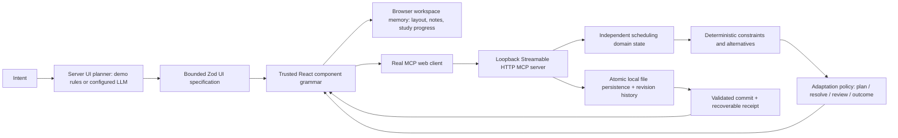

# ShadowUI · RABEN

**תיעוד המערכת בעברית:** [מטרה, יכולות, ארכיטקטורה, נתונים, התקנה ומגבלות](docs/system-overview.he.md).

**When the work changes, the interaction should change with it.** ShadowUI is an adaptive software prototype: express an objective, work inside a composed interface, change the situation, compare solutions, and confirm a verifiable result.

ShadowUI composes interactive tools around goals across scheduling, source-based learning, budgets, comparisons, inventory, documents, and bounded calculations. Task coverage, input readiness, and user-reviewed completion are separate states. Follow-up edits retain compatible work, and the latest local workspace edit can be undone.

**Runtime modes:** `AI_ENABLED=false` keeps the no-cost local simulation. With explicit server configuration `AI_ENABLED=true`, a server OpenAI key, Firebase and durable budget storage, the same validation pipeline uses real AI for task interpretation and component generation. Ordinary edits and calculations remain local. Failed or unavailable live AI does not silently fall back to simulation.

Private validated tools are reusable. With the demo Firebase emulators running, sanitized candidates enter `/admin/components` for authenticated review, simulated edit proposals, and explicit approval into a separate shared definition. Configured hosted environments use real Firebase storage and verified administrator authentication; local emulators remain available for testing. See [local setup and review](docs/local-simulation.md).

See [current verification and limits](docs/adaptive-workspace-verification.md).

GitHub Actions runs unit, production build, TypeScript, Chromium browser and Firebase emulator checks on every push and pull request. See the [Hebrew CI guide](docs/ci.md) for results, local commands and required merge checks.

## Task-aware catalog

The task pipeline now builds a validated task contract, selects capability-compatible components from Firestore, composes typed local data bindings, and can generate private validated calculators when no catalog formula fits. Visit `/catalog` for browsing, interactive previews and authenticated version management. Instance edits stay in this browser; catalog definitions persist in Firebase. See [configuration, behavior and limitations](docs/component-catalog.md).

## Run

Node.js 20.9+ and installed Google Chrome for browser tests.

```sh
npm ci
npm run dev
```

Open [ShadowUI](http://localhost:3000). The workspace works without API keys, using browser storage for workspaces and an ignored local file for reusable private definitions. For the full Firebase catalog and administrator workflow, use `npm run dev:simulation` and its local emulator identity. Existing production credentials are not used.

```sh
npm run typecheck
npm test
npm run build
npm start
# With an app server running in another terminal:
npm run test:e2e
node scripts/capture-mcp-evidence.mjs
```

Development uses `.next-dev`, while production builds and `npm start` use `.next`, so building does not overwrite a running development server's assets. If you override `SHADOWUI_DIST_DIR`, use separate directories for development and production. The test suite uses Chrome in reduced-motion mode; normal browser operation retains subtle transitions.

## Scheduling demonstration

1. Choose **Build a conflict-free week**, or type “Organize next week's shifts for six employees, including Daniel.” The roster is an editable October 19–23, 2026 fixture.
2. In availability controls, choose Daniel and **2026-10-21**, then **Mark unavailable**. The server detects Daniel's conflicting assignment. The interface automatically focuses on eligible replacement comparisons; no AI call or extra “build a conflict UI” instruction is needed.
3. Select a replacement. A preview shows the before/after assignment and constraint outcome without modifying authoritative data. Reject it or **Apply proposal**.
4. Choose **Review & confirm**, then **Confirm internal schedule**. The MCP tool validates all constraints again, writes the committed revision, and returns a persisted receipt. This is a real internal server action, not an employer-system update.
5. Refresh, visit another workspace and return. The same receipt is retrieved. **Undo** restores the preceding draft through another actual server operation.

The prompt also supports the explicit constraint “Daniel cannot work Wednesday and everyone needs two days off.” Ambiguous or unsupported schedule commands request a supported control/clarification instead of claiming execution.

## Hosted demonstration

On non-loopback browser hosts, scheduling runs as a browser-local demo using the same deterministic constraints. Schedule history, revisions and demo confirmation records are saved in localStorage for that browser and origin. They are not backend receipts, are not shared across devices, and disappear when browser data is cleared. Cross-tab writes are not transactionally coordinated. Hosted scheduling does not invoke MCP; the real loopback MCP path remains available when running locally. Paid AI is disabled by default; explicitly configured live environments use the guarded server pipeline described below.

## Architecture and persistence



`lib/schema.ts`, `lib/planner.ts`, and `lib/patch.ts` retain the original compositional engine and stable IDs. Sixteen trusted component types support checklist, timeline, calendar, weekly schedule, kanban, flashcards, quiz, slider, editable table, weighted comparison, notes, timer, approval, chart, links, and custom tools. Independent capability rules can combine these for unfamiliar goals. The model produces JSON, never executable application code.

`lib/schedule.ts` contains the separate domain model, interval-overlap checks, unavailable-date checks, uncovered-shift checks, per-week days-off enforcement and candidate evaluation. `lib/adaptation.ts` selects interaction modes from actual facts and records the objective, trigger, reason, preserved state and allowed actions. Clear conditions run deterministically; configured AI is reserved for semantic interface planning, not ordinary clicks.

`lib/schedule-store.ts` serializes writes in one Node process, validates state and atomically renames local files under `.shadowui/` (ignored by Git). Revisions reject stale writers; action IDs make retries idempotent; confirmed commits produce receipts; undo consumes real history. Storage failures remain errors. `SHADOWUI_DATA_DIR` can select another local directory. This requires a writable persistent filesystem; it is not a multi-process database or an ephemeral-serverless deployment solution.

Browser workspace memory and server scheduling records are separate. Refreshing or switching layouts does not recreate domain data. Clearing browser storage removes navigation references; backend files are not deleted. The current Export button downloads a styled PNG of the workspace, not a recoverable backup of workspace data or server history. Running focus countdowns reset on remount, while duration and meaningful task edits persist.

## Real MCP capabilities

[Web test host](http://localhost:3000/mcp-host) is explicitly a **simulated Alexa+ host**. The main scheduling UI is also a real MCP client: initialize → initialized notification → tools/list → tools/call. The endpoint implements JSON-response Streamable HTTP, supported protocol revisions **2025-11-25** and **2025-03-26**, and GET 405 because server-initiated SSE is absent.

| Tool | Real effect |
|---|---|
| `compose_workspace` | Returns a validated demo proposal; no implicit save |
| `validate_workspace` | Checks the bounded component grammar |
| `create_schedule` | Creates or retrieves the server-local draft |
| `inspect_schedule` | Reads authoritative state, constraints and eligible alternatives |
| `preview_schedule_change` | Computes a candidate without writing |
| `update_schedule` | Applies explicit operations or undo with revision/idempotency guards |
| `commit_schedule` | Requires literal confirmation and a valid schedule; persists a receipt |

Mutating calls carry `expectedRevision` and `actionId`. Previews carry a revision; confirmation must be `true`. Tool failures carry `isError` and a machine error code. The UI shows pending, failure, retry and success states. A retry reuses its original action ID. A superseded action is rejected rather than presenting an outdated receipt as current.

This unauthenticated demo accepts **loopback hosts only** and rejects cross-origin requests. It is a genuine locally self-hosted MCP flow, **not** a public Alexa+ service. Remote judging access requires an explicitly prepared hosted demonstration or authorized secure deployment. No physical Alexa+ execution, account connection or certification is claimed. [Protocol reference](https://modelcontextprotocol.io/specification/2025-11-25/basic/transports).

## Earlier evidence and evaluation

- [Verified implementation and boundaries](docs/verification.md): 32 logic tests, 12 browser checks and production build passed.
- [Recorded actual HTTP MCP exchanges](docs/evidence/mcp-flow.json): discovery, blocked invalid commit, nonmutating preview, applied repair, confirmed receipt, duplicate-action replay and reinspection. All roster data is synthetic.
- `tests/evaluation.test.ts`: five cases exercise the hero, tighter constraints, another domain, unfamiliar capability composition and unsupported external execution. These are deterministic/store-level assertions, not proof of universal intelligence or paid-provider quality.
- `tests/e2e/hero.spec.ts`: repeats the principal workflow three times; checks failure/retry, refresh, cross-workspace continuity and undo through actual HTTP tools.
- `tests/e2e/reliability.spec.ts`: invalid model output, unsupported execution, stale sessions, mobile and RTL.
- `tests/e2e/workspace.spec.ts`: preserves the original study, budget, comparison and unfamiliar-goal paths.

## Boundaries

The hero intentionally supports the named six-person fixture; a different requested roster size returns an explicit unsupported-constraint error. Dates and slots are fixture data. Employee availability, assignments and minimum days off are editable; dynamic hiring, payroll, qualifications, labor-law compliance and external scheduling integrations are absent. Alternative scores favor lower assigned hours; they are deterministic heuristics, not predictions or a full staffing optimizer. Impossible constraints remain blocked.

The grammar is reusable, but the hero's domain binding and constraints are implemented specifically. Arbitrary unfamiliar workflows can receive local planning controls; they do not gain unimplemented external actions. Nonbiology demo learning asks for user-provided source material. Travel costs and decision scores are editable estimates. An explicit persisted language control supports Hebrew/RTL and English/LTR; some labels and demo content remain English. Configured live semantic planning and account synchronization are implemented, but their operation in any particular deployment requires verification. Full localization, physical Alexa+, user research and measured time savings are not established by this code.

## Submission preparation

- [2:50 demonstration script](docs/demo-guide.md)
- [Skeptical product/judging assessment](docs/strategy.md)
- [Pre-submission checklist](docs/submission-checklist.md)

Internal target: **October 21 evening, Jerusalem time**. Official rules checked October 18 state **October 23, 2026, noon PDT (22:00 Jerusalem)**; recheck before submitting. No submission, judging access, eligibility or competitive outcome is claimed. [Official rules](https://amazonappdev2026.devpost.com/rules).

### Goal-specific custom tools

The simulated provider can create a `custom` tool when the built-in tools do not fit the requested action. It composes named number, text, select and toggle fields with validated local calculations, three layouts (form, metrics, steps), and four accents. The planner avoids default filler cards and explains each tool's purpose. Generation in this phase uses no model request.

Custom definitions are declarative data, not executable code. Calculations support bounded RPN arithmetic (+, -, *, /, min, max); division by zero and non-finite results show errors. Stable field values survive AI adaptations when compatible with new bounds/options. Browser persistence includes the definition and values; the current UI export creates a PNG image. This supports local forms and scenario calculators; arbitrary apps, new network integrations, and external actions require implementation. The simulation also exercises private creation, persistence, and reuse through injected providers.
