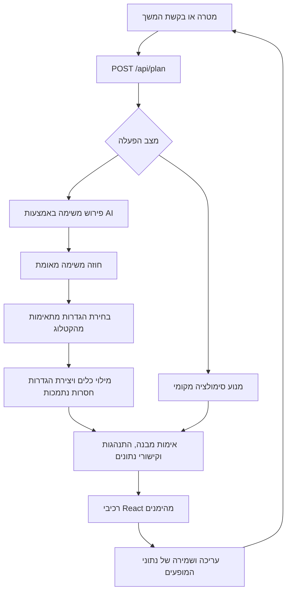

# ShadowUI — תיעוד המערכת

מסמך מרכזי למוצר ולמימוש, מעודכן לפי הקוד ברפוזיטורי ב־21 באוקטובר 2026. הוא מתאר יכולות ממומשות ותלויות תצורה; הוא אינו אישור שפריסה מסוימת הוגדרה או נבדקה. מדריכי הבדיקות הישנים מתעדים ראיות במועד שבו נכתבו.

## המטרה

ShadowUI הופכת מטרה שנכתבת בשפה טבעית לסביבת עבודה אינטראקטיבית. במקום לקבל רק תשובה בצ׳אט או לבחור מראש אפליקציה קשיחה, המשתמש מקבל כלים שמתאימים למשימה: טבלה, רשימת פעולות, לוח שבועי, מחשבון, כלי השוואה, כרטיסיות למידה ועוד.

המשתמש עובד ישירות בתוצר, מזין נתונים, משנה אילוצים ומבקש התאמות. המערכת שואפת לשמר עבודה תואמת שכבר נעשתה ולהחליף או להוסיף את הכלים הנדרשים. העיקרון המנחה הוא ש־AI מפרש את הבקשה ומציע מבנה; קוד דטרמיניסטי מאמת נתונים, מחשב תוצאות ומבצע את הפעולות שהמערכת אכן תומכת בהן.

זהו אבטיפוס תוכנה עם סביבת עבודה שימושית ומנוע הרכבה מוגבל ומאומת. אין בו יכולת כללית לבנות ולהריץ כל תוכנה, לבצע כל משימה חיצונית או להבטיח שהמטרה העסקית הושגה.

## מה המשתמש יכול לעשות

- לכתוב מטרה חדשה או להתחיל מדוגמה, ולקבל סביבת עבודה עם כלים והסבר לבחירתם.
- לערוך נתונים בכלים עצמם: רשומות, טקסטים, פריטים, ציונים, משקלים, מועדים וערכי חישוב לפי סוג הכלי.
- לשלוח בקשות המשך, שאלות ושינויים. הודעה יכולה להוביל לתשובה בשיחה, לבקשת הבהרה או לעדכון סביבת העבודה.
- לשמור כמה שיחות וסביבות עבודה, לעבור ביניהן ולמחוק דרך הממשק. היסטוריית ההודעות מוגבלת ל־12 הודעות לשיחה.
- לבטל את עריכת סביבת העבודה המקומית האחרונה. לשיבוץ משמרות יש מנגנון היסטוריה וביטול נפרד.
- להוריד תמונת PNG מעוצבת של סביבת העבודה. כפתור Export הנוכחי אינו גיבוי של מסד הנתונים או של היסטוריית המשמרות.
- לבחור עברית או אנגלית דרך כפתור השפה. הבחירה נשמרת במכשיר בנפרד משפת ההודעות; הממשק תומך בכיווניות RTL/LTR, עם חלקים וטקסטי דוגמה שנותרו באנגלית.
- להשתמש כמשתמש אורח או להיכנס לחשבון מאומת ולסנכרן נתוני עבודה בין מכשירים, כאשר Firebase מוגדר.
- לעיין בקטלוג כלים ב־`/catalog`; מנהל מורשה יכול לנהל הגדרות וגרסאות ולעבור על מועמדים לשיתוף ב־`/admin/components`.

## דוגמאות למשימות

| תחום | תוצר אפשרי | גבול היכולת |
| --- | --- | --- |
| למידה | כרטיסיות, שאלון, רשימת נושאים וטיימר | איכות התוכן תלויה במקור ובמצב ההפעלה; אין הבטחת נכונות פדגוגית |
| תקציב ותכנון | טבלת סכומים, מחוון ותרשים | הערכות ונתונים שהוזנו, ללא חיבור לבנק |
| החלטה | חלופות, קריטריונים ומשקלים | ניקוד מחושב לפי הקלט, ללא הבטחת החלטה מיטבית |
| מלאי ואיסוף מידע | טבלת רשומות וטופס מוגדר | עריכה מקומית, ללא סנכרון אוטומטי למערכת מלאי חיצונית |
| חישוב ייעודי | שדות קלט ונוסחה מוגבלת | פעולות נתמכות בלבד, ללא קוד שנוצר ומורץ |
| תכנון שבוע | לוח ימים ובלוקי זמן | כלי תכנון פנימי, ללא חיבור ליומן חיצוני |
| שיבוץ משמרות | זיהוי התנגשויות, חלופות, תצוגה מקדימה ואישור | תרחיש הדגמה מוגדר של שישה עובדים |

## מצבי הפעלה

### סימולציה מקומית

`AI_ENABLED=false` הוא ברירת המחדל. מנוע הסימולציה משתמש בכללים ובספק מקומי כדי ליצור ולהתאים כלים ללא פנייה בתשלום למודל. בלי אמולטורים, הגדרות פרטיות נשמרות בקובץ המקומי `.shadowui/simulation/definitions.json`; נתוני העבודה נשמרים בדפדפן. כניסת מנהל אינה זמינה במצב קבצים זה.

`npm run dev:simulation` מפעיל גם אמולטורי Firebase Auth ו־Firestore בפרויקט הדגמה מבודד. כך אפשר לבדוק קטלוג, הרשאות ותהליך סקירת רכיבים. נתוני האמולטור אינם מיוצאים כברירת מחדל, ולכן אינם נשמרים בין הפעלות. זו אינה כניסה לחשבון Google אמיתי, והסימולציה אינה הבטחה לפעולה מלאה ללא אינטרנט.

### AI חי

נדרשים `AI_ENABLED=true`, מפתח OpenAI שרתי, Firestore מוגדר ואחסון תקציב תקין. בפריסה מרובת תהליכים או serverless נדרש אחסון תקציב עמיד ומשותף. כשל בתצורה או בספק מוצג כשגיאה; תוצאת סימולציה אינה מוצגת כתוצאת AI חי.

בחירת המודל והערכות המחיר מוגדרות ב־`lib/ai-model.ts`. לפי הקוד הנוכחי, לאחר מועד הניסוי הקבוע באוקטובר 2026 נבחר `gpt-4.1-mini`. אלה ערכי תצורה בקוד, ולא בירור זמינות או מחיר עדכני אצל הספק.

פעולות רגילות כמו הקלדה, סימון וחישוב אינן מחייבות פנייה למודל. פירוש משימה, הרכבת תוכן וחיפוש סמנטי בקטלוג עשויים להשתמש במודל או ב־embeddings. התקציב והמטמון משותפים למנגנון הבקרה המתועד ב־[תפעול AI](ai-operations.md).

## מסלול הבקשה



1. הממשק שולח מטרה, סביבת עבודה נוכחית כשישנה והיסטוריה מוגבלת. הנתונים נבדקים מול סכמות וגבולות גודל.
2. המנוע מבחין בין שיחה, שאלה, הבהרה ומשימה. משימה מתוארת כחוזה הכולל פעולות, תלות ביניהן, יכולות נדרשות, קלטים וקריטריוני הצלחה.
3. במצב חי נבחרים כלים פרטיים של הסשן וכלים משותפים פעילים. התאמה ליכולת ולסכמת הקלט נבדקת לפני דירוג סמנטי ובחירה משלימה של כלים.
4. המערכת ממלאת כלים נתמכים. כשחסר כלי מתאים, היא יכולה ליצור הגדרה הצהרתית פרטית במסגרת יכולות הרינדור הקיימות.
5. סכמות, מזהים, הפניות, כיסוי פעולות, נוסחאות וקישורי נתונים נבדקים. יש לכל היותר תיקון ממוקד אחד במסלול החי; כשל רשת אינו גורר ניסיון אוטומטי נוסף.
6. רק תוצאה שעברה אימות מיושמת. התאמות שומרות ערכים ושינויים תואמים באמצעות מזהים ומנגנוני patch ופיוס מצב.
7. בזרם החי השרת שולח אירועי SSE של התקדמות, תוצאה או שגיאה. הממשק מציג שלבים שדווחו מהשרת; JSON חלקי אינו מיושם כסביבת עבודה.

כיסוי משימה, מוכנות הקלט והשלמה שאושרה בידי המשתמש הם מצבים שונים. עצם יצירת כלי מתאים אינה הוכחה שהמשתמש השלים את הפעולה או שבוצעה פעולה בעולם החיצוני.

## כלים, הגדרות ומופעים

`lib/schema.ts` מגדיר 16 סוגי רכיבים:

| סוג בקוד | תפקיד |
| --- | --- |
| `checklist` | רשימת פעולות וסימון ביצוע |
| `timeline` | רצף שלבים או מועדים |
| `calendar` | הצגת פריטים לפי תאריכים |
| `weekly_schedule` | שבעה ימים רצופים עם בלוקי זמן |
| `kanban` | חלוקה לקבוצות או שלבי עבודה |
| `flashcards` | כרטיסיות שאלה ותשובה |
| `quiz` | שאלות ותרגול |
| `slider` | שינוי ערך מספרי לתרחיש |
| `table` | נתונים טבלאיים וכלי רשומות מוגדרים |
| `comparison` | השוואה עם קריטריונים ומשקלים |
| `notes` | טקסט והערות |
| `timer` | זמן מיקוד; ספירה פעילה מתאפסת בטעינה מחדש של הרכיב |
| `approval` | סקירה ואישור בתוך סביבת העבודה |
| `chart` | הצגה חזותית של ערכים |
| `links` | קישורי HTTP/HTTPS |
| `custom` | טופס או מחשבון הצהרתי מוגבל |

הגדרת כלי מתארת מבנה ויכולות לשימוש חוזר; מופע מכיל את נתוני המשתמש בסביבת עבודה מסוימת. הפניה לקטלוג מצמידה מופע לגרסה מפורשת. גרסאות היסטוריות נשמרות, והחלפת הגדרה אינה משדרגת אוטומטית מופעים קיימים.

חישובים מותאמים משתמשים בביטויי RPN מוגבלים, כולל חיבור, חיסור, כפל, חילוק, מינימום ומקסימום. חלוקה באפס ותוצאות לא סופיות נדחות. קישורי נתונים בין כלים מאפשרים פעולות מוגדרות כגון העתקה, הקרנה, סכימה וספירה; התלויות נבדקות. AI אינו מחזיר JavaScript להרצה.

## נתונים ושמירה

| מידע | מיקום | משמעות |
| --- | --- | --- |
| סביבות עבודה ושיחות אורח | אחסון דפדפן | מוגבל למכשיר, לפרופיל ולמקור האתר |
| עותק מקומי של חשבון | אחסון דפדפן מופרד לפי זהות | נשמר גם כשסנכרון נכשל; אינו מוצפן על ידי המערכת |
| תמונת מצב של חשבון מאומת | Firestore: `shadowui_account_workspaces/{uid}` | נגיש דרך API מאומת; כולל שיחות, סביבות עבודה ונתוני שיבוץ דפדפן |
| הגדרות קטלוג וגרסאות | Firestore: `shadowui_component_catalog` | נפרדות מנתוני המופעים; כלים פרטיים בקטלוג משויכים לסשן |
| מועמדים לסקירת מנהל | Firestore: `shadowui_component_reviews` | אישור יוצר הגדרה משותפת נפרדת |
| embeddings של הגדרות | Firestore: `shadowui_catalog_embeddings` | משויכים לגרסה ותוכן |
| הגדרות סימולציה ללא אמולטור | `.shadowui/simulation/definitions.json` | קובץ מקומי שאינו נכלל ב־Git |
| שיבוץ דרך MCP מקומי | קבצים תחת `.shadowui/` או `SHADOWUI_DATA_DIR` | מצב שרתי נפרד, עם גרסאות וקבלות |
| שיבוץ באתר שאינו loopback | אחסון דפדפן; נכלל בסנכרון חשבון מאומת | אישור הדגמה, ללא קבלה משרת MCP |
| תקציב, שמורות תשלום ומטמון AI | Redis או מערכת קבצים עמידה לפי תצורה | אינו מתאפס חודשית; אין למחוק כדי לאפס הוצאות |

מחיקת נתוני דפדפן יכולה למחוק נתוני אורח ועותקים מקומיים. יציאה מחשבון מפרידה את ההיסטוריה המוצגת אך אינה הצפנה או מחיקה מרחוק של העותק במכשיר. תמונת PNG אינה גיבוי ניתן לשחזור.

## חשבונות וסנכרון

המערכת משתמשת ב־Firebase Authentication עם Google ואימייל/סיסמה. אימות אימייל נדרש לצורך בעלות חשבון וסנכרון ענן. נכללים מסכי הרשמה, התחברות, שליחה חוזרת של הודעת אימות, בדיקת אימות, איפוס סיסמה וקישור ספקים בתנאים הנתמכים.

השרת קובע בעלות לפי UID שהתקבל מטוקן Firebase מאומת ובודק ביטול הרשאות; הוא אינו סומך על אימייל או UID בגוף הבקשה. זהות בעלת כתובת אימייל זהה אינה אישור למיזוג חשבונות עצמאיים.

הסנכרון שומר עותק מקומי ובסיס ענן אחרון, ומשתמש בטרנזקציה וב־`expectedRevision` כדי למנוע דריסה שקטה ממכשיר ישן. שינויים מקבילים באותה שיחה יכולים להישמר בעותקים נפרדים. הסנכרון מופעל לאחר עריכה, בחזרה לחלון, בחזרת חיבור ובכל 15 שניות כשהדף גלוי. בחירת השיחה הפעילה נשארת מקומית למכשיר.

הגבולות הם 250 סביבות עבודה ו־700,000 בתים לתמונת מצב מסוריאלית; גוף בקשת הסנכרון מוגבל ל־750,000 בתים. כשל סנכרון משאיר את העותק המקומי ואת חיווי ההמתנה. ראו [סנכרון חשבונות](account-sync.md) ו־[אימות וקישור ספקים](account-auth.md).

## קטלוג וסקירת מנהל

הקטלוג מאפשר עיון, חיפוש, סינון ותצוגה מקדימה. כתיבה וניהול גרסאות דורשים הרשאת מנהל שנבדקת בשרת. ניהול כולל עריכת JSON, בדיקת תקינות, הפעלה, הוצאה משימוש וחזרה לגרסה קודמת באמצעות גרסה חדשה.

כלי פרטי אינו הופך לציבורי רק מפני שנוצר. תהליך הסקירה מייצר מועמד מסונן עם נתוני דוגמה, מאפשר בדיקה ועריכה, ודורש אישור מפורש ליצירת הגדרה משותפת נפרדת. היסטוריית הכלי הפרטי אינה מתפרסמת. יש לבדוק את מועמד השיתוף; סינון אוטומטי אינו אישור לפרסום כל תוכן.

ראו [קטלוג הרכיבים](component-catalog.md) ו־[סימולציה וסקירה](local-simulation.md).

## תרחיש שיבוץ המשמרות ו־MCP

זהו מסלול תחום נפרד עם נתוני הדגמה של שישה עובדים ושבוע באוקטובר 2026. המנוע בודק חפיפות, זמינות, משמרות לא מכוסות ומינימום ימי חופש. חלופות מדורגות לפי כללים דטרמיניסטיים, כולל שעות שיבוץ; אין כאן אופטימיזציה כללית של כוח אדם.

הזרימה היא יצירת טיוטה, בדיקת מצב, שינוי זמינות, איתור התנגשות, השוואת מחליפים, תצוגה מקדימה, החלה ואישור מפורש. אישור בודק שוב את האילוצים. שינוי משתמש בגרסה צפויה ובמזהה פעולה כדי לזהות כתיבה מיושנת וחזרה על אותה פעולה.

| כלי MCP | פעולה |
| --- | --- |
| `compose_workspace` | יצירת הצעת סביבת עבודה במצב demo |
| `validate_workspace` | אימות סביבת עבודה לפי הסכמה |
| `create_schedule` | יצירה או שליפה של טיוטת שיבוץ |
| `inspect_schedule` | קריאת מצב, אילוצים וחלופות |
| `preview_schedule_change` | חישוב שינוי ללא כתיבה |
| `update_schedule` | החלת שינוי או ביטול עם בדיקות גרסה וזהות פעולה |
| `commit_schedule` | אישור מפורש ושמירת קבלה לאחר אימות |

ב־localhost הממשק הוא לקוח MCP אמיתי מול `POST /api/mcp`, עם initialize, גילוי כלים וקריאות כלים. השרת מקבל loopback בלבד ודוחה בקשות ממקור אחר. הוא תומך בתגובות JSON של Streamable HTTP, ללא זרם SSE יזום מהשרת. `/mcp-host` הוא מארח הדגמה המדמה Alexa+.

באתר שאינו loopback נעשה שימוש בחנות שיבוץ בדפדפן. רישום אישור שם הוא אישור הדגמה מקומי. סנכרון חשבון יכול להעביר את מצב הדפדפן בין מכשירים; הוא אינו הופך אותו לקבלת MCP שרתית. כתיבה מקבילה בין טאבים אינה טרנזקציונית. אין חיבור למערכת מעסיק או למכשיר Alexa+ פיזי.

## מבנה הקוד

| נתיב | אחריות |
| --- | --- |
| `app/page.tsx` | מסך ראשי, שיחות, יצירה והתאמה, שמירה ותיאום סנכרון |
| `components/WorkspaceRenderer.tsx` | רינדור הכלים המהימנים ושינוי נתוני מופעים |
| `components/FloatingAssistant.tsx` | ממשק עוזר ושיחה סביב סביבת העבודה |
| `components/WorkspaceLayout.tsx` | פריסה ותנועת סביבת העבודה |
| `components/AIProgress.tsx` | תצוגת התקדמות מדווחת |
| `lib/schema.ts`, `lib/patch.ts`, `lib/instance-state.ts` | סכמות, התאמה ושימור מצב |
| `lib/task-contract.ts`, `lib/task-pipeline.ts`, `lib/task-engine.ts` | חוזה משימה, תזמור והרכבה |
| `lib/task-ai.ts`, `lib/semantic-search.ts` | קריאות מודל וחיפוש סמנטי |
| `lib/custom-tool.ts`, `lib/record-tool.ts`, `lib/data-bindings.ts` | חישובים, רשומות וקישורי נתונים |
| `lib/catalog*.ts`, `lib/component-review*.ts` | הגדרות, גרסאות וסקירת מנהל |
| `lib/account-*.ts`, `lib/workspace-sync.ts` | בעלות, תמונות מצב ופיוס סנכרון |
| `lib/firebase-client.ts`, `lib/firebase-admin.ts` | תצורת Firebase בדפדפן ובשרת |
| `lib/schedule*.ts`, `lib/browser-schedule-store.ts`, `lib/adaptation.ts` | תחום השיבוץ, אחסון והתאמת הממשק |
| `lib/mcp-client.ts`, `app/api/mcp/route.ts` | לקוח ושרת MCP |
| `lib/ai-policy.ts`, `lib/ai-model.ts`, `lib/ai-budget.ts` | אישור שימוש ב־AI, בחירת מודל ותקציב |
| `lib/simulated-workspace.ts` | מסלול הסימולציה |
| `lib/workspace-image.ts` | יצוא PNG |
| `tests/`, `scripts/`, `.github/workflows/` | בדיקות, כלי תפעול ו־CI |

הטכנולוגיות העיקריות הן Next.js App Router, React, TypeScript, Zod, Firebase Auth/Firestore ו־Motion. השרת רץ בסביבת Node.js.

## משטחי API

| נתיב | שימוש |
| --- | --- |
| `GET /api/plan` | סטטוס תצורת AI, תקציב ויצירת cookie לסשן |
| `POST /api/plan` | שיחה, הבהרה, יצירה והתאמה; במסלול חי מוחזר SSE, ובפירוש שיבוץ JSON |
| `GET/PUT /api/account/workspaces` | קריאה ושמירת תמונת מצב לפי חשבון מאומת וגרסה |
| `/api/catalog`, `/api/catalog/[id]` | קריאת קטלוג ופעולות ניהול מוגנות |
| `/api/admin/components`, `/api/admin/components/[id]` | תור סקירה ופעולות מנהל מוגנות |
| `POST /api/mcp` | פרוטוקול MCP מקומי וכלי השיבוץ |

יש לקרוא את הסכמות וה־handlers לפני כתיבת לקוח חדש; הטבלה מתארת אחריות ולא מחליפה חוזה פרוטוקול מלא. בקשות תכנון וסנכרון מוגנות בבדיקות מקור, גודל ומבנה לפי המסלול. סשן תכנון אינו אימות משתמש או הרשאת מנהל.

## התקנה ותצורה

נדרש Node.js בגרסה 20.9 ומעלה. בדיקות דפדפן דורשות Chrome בהתאם ל־`playwright.config.ts`; אמולטורים דורשים Firebase CLI ו־Java.

```sh
npm ci
npm run dev
# http://localhost:3000
```

להרצת סביבת הסימולציה המלאה:

```sh
npm run dev:simulation
```

משתני התצורה מתועדים ב־[`.env.example`](../.env.example). אין להעתיק סודות למסמכים או ל־Git.

| קבוצה | משתנים מרכזיים |
| --- | --- |
| AI שרתי | `AI_ENABLED`, `OPENAI_API_KEY`, `AI_BUDGET_USD` |
| אחסון תקציב עמיד | `UPSTASH_REDIS_REST_URL`, `UPSTASH_REDIS_REST_TOKEN` או `AI_STATE_DIR` |
| Firebase שרתי | `FIREBASE_PROJECT_ID`, `FIREBASE_SERVICE_ACCOUNT_JSON` או Application Default Credentials, `FIREBASE_ADMIN_EMAIL` |
| Firebase ציבורי לבנייה | ארבעת משתני `NEXT_PUBLIC_FIREBASE_*` בדוגמה |
| אמולטורים מקומיים בלבד | `FIRESTORE_EMULATOR_HOST`, `FIREBASE_AUTH_EMULATOR_HOST` עם פרויקט `demo-` |
| קבצים ובנייה | `SHADOWUI_DATA_DIR`, `SHADOWUI_DIST_DIR` |

אין לתת למפתח OpenAI או לחשבון שירות קידומת `NEXT_PUBLIC_`. משתני Firebase הציבוריים הם תצורת לקוח ואינם מפתח חשבון שירות. יש להגדיר ספקי התחברות, דומיינים מורשים, מסד Firestore והרשאות שרת; עצם קיומם של משתנים אינו מוכיח שהשירות עובד.

הפיתוח משתמש ב־`.next-dev`; build ושרת production משתמשים ב־`.next`. יש לשמור הפרדה גם כשמשנים `SHADOWUI_DIST_DIR`. אחסון שיבוץ בקובץ אינו פתרון למסד נתונים מרובה תהליכים או לדיסק זמני ב־serverless.

## אבטחה, פרטיות ועלויות

- תוצרים עוברים אימות סכמה ומרונדרים ברכיבים מוכרים. אין מסלול להרצת קוד שרירותי שנוצר בידי המודל.
- גישת חשבונות נשענת על טוקן מאומת, UID וגרסאות; כתיבות קטלוג וסקירה דורשות הרשאת מנהל. כללי Firestore מיועדים לחסום לקוח ישיר; Admin SDK כפוף להרשאות השרת.
- במצב חי תוכן בקשה, מצב עבודה והקשר רלוונטי נשלחים לספק AI. אין לשלוח מידע שאין הרשאה לעבד בדרך זו. מטמון ותמונות מצב יכולים לכלול נתוני משתמש.
- תקציב AI הוא אומדן מצטבר עם שמירת עלות מראש, הסדרת שימוש, הגבלת קצב ומניעת כפילויות. ברירת המחדל היא דולר אחד והטווח המותר עד חמישה דולרים; אין איפוס חודשי אוטומטי.
- מחיקת ledger, שינוי מחירי ספק או שימוש חיצוני במפתח יכולים לשבור את הקשר לאומדן. זה אינו חסם חיוב מוחלט אצל ספק המודל.
- כשל בספק או באחסון מוצג בממשק. נתונים מקומיים נשמרים ככל שהדפדפן מאפשר; אחסון דפדפן אינו תחליף לגיבוי או להצפנה.

## בדיקות ותחזוקה

```sh
npm run typecheck
npm test
npm run build
npm start
# כשהשרת פועל, בטרמינל נוסף:
npm run test:e2e
# דורש Firebase CLI ו-Java:
npm run test:catalog
```

`npm run verify:task-live` דורש ספק ומסד נתונים אמיתיים ויכול לצרוך תקציב AI. בדיקות mock ואמולטורים אינן ראיה לאיכות מודל חי, למסירת אימייל או להגדרת production. פרטי CI נמצאים ב־[מדריך CI](ci.md).

בעת תקלה יש להבחין בין שכבות: תצורת דפדפן והתחברות; API ושרת; Firebase והרשאות; ספק AI ותקציב; שיבוץ מקומי לעומת שיבוץ דפדפן. לדוגמה, סביבת עבודה שמוצגת מקומית אינה הוכחה לסנכרון ענן, ו־HTTP תקין אינו הוכחה שהמשימה בוצעה.

## מגבלות והמשך פיתוח

אין חיבור מובנה לבנק, הזמנות, תשלומים, מערכת מעסיק, חיפוש אינטרנט כללי או יומן חיצוני. כלי תכנון או כפתור אישור אינם מבצעים שירות שלא מומש. גם הגדרה חדשה שנוצרה חייבת להישאר בתוך גבולות הרכיבים והפעולות הקיימים.

שיבוץ המשמרות מוגבל לנתוני ההדגמה, ללא קליטת צוות חופשי, שכר, הכשרות או אימות דיני עבודה. נוסחאות נבדקות מבנית ובתרחישי אימות מוגבלים; אין הוכחה אוניברסלית לנכונותן העסקית. דגלי נגישות בהגדרות אינם הסמכת נגישות מלאה. אין כאן ראיה למחקר משתמשים, לחיסכון מדוד בזמן או לאיכות מודל לכל משימה אפשרית.

אימות בפריסה אמיתית צריך לכלול התחברות ואימות אימייל, שני פרופילי דפדפן לאותו חשבון, שמירה וטעינה מחדש, כשל ושחזור חיבור, הרשאות מנהל, אחסון תקציב עמיד ובקשת AI מבוקרת. מסמך זה נכתב מסקירת קוד; הוא אינו מדווח שהבדיקות החיות הללו בוצעו כעת.

## מפת התיעוד

- [README](../README.md): כניסה לפרויקט, הרצה ותרחיש ההדגמה.
- [תפעול AI](ai-operations.md): תקציב, תצורה, שגיאות וגבולות אימות.
- [קטלוג רכיבים](component-catalog.md): בחירה, יצירה, גרסאות וניהול.
- [סימולציה וסקירת רכיבים](local-simulation.md): סביבת אמולטורים וזרימת מנהל.
- [חשבונות](account-auth.md) ו־[סנכרון](account-sync.md): זהות, קישור ספקים ושמירה בענן.
- [CI](ci.md): פקודות ובדיקות אוטומטיות.
- [אימות סביבת העבודה](adaptive-workspace-verification.md) ו־[אימות MCP](verification.md): ראיות היסטוריות והסתייגויות.
- [מדריך הדגמה](demo-guide.md), [אסטרטגיה](strategy.md) ו־[רשימת הגשה](submission-checklist.md): חומרי ההדגמה והתחרות המקוריים, עם תאריכים וגבולות כפי שתועדו אז.
